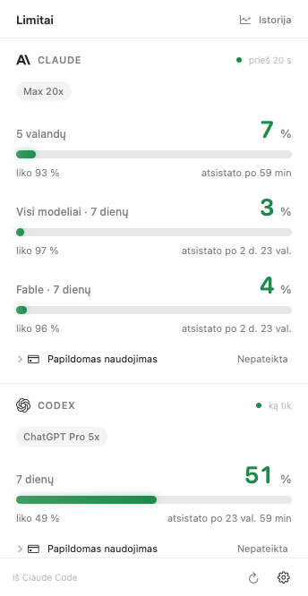
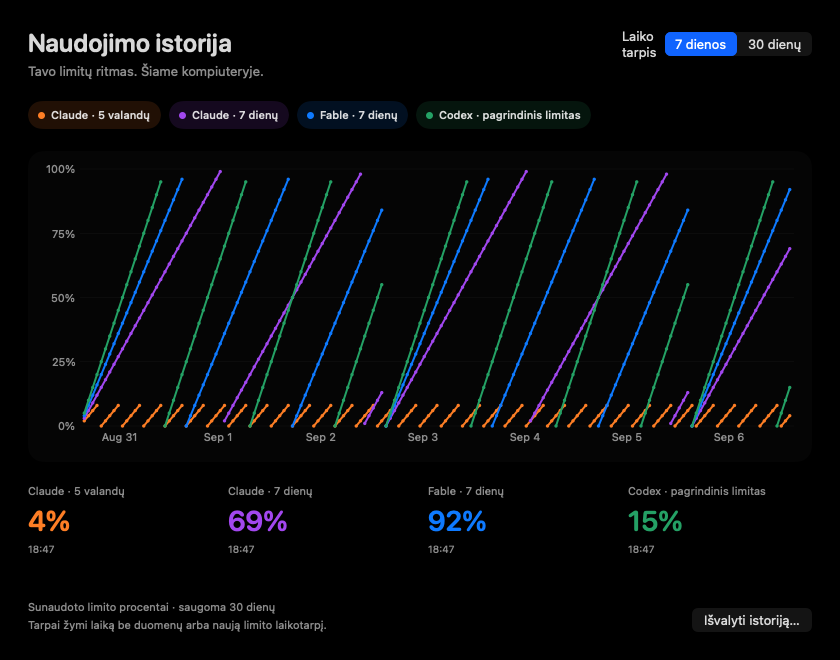

# POM — Claude ir Codex limitai macOS meniu juostoje

**Matyk, kiek naudojimo liko, neatsitraukdamas nuo darbo.**
POM viename lange parodo Claude ir Codex prenumeratos limitus, jų atsistatymo laiką
bei papildomus kreditus.

[English](README.md) · [Atsisiųsti](https://github.com/ponasObuolys/POM-Ponas-Obuolys-Metrics/releases) · [Diegimo pagalba](docs/INSTALL.txt)

> **Kuriama 2.2 versija.** Toliau aprašytos funkcijos jau įgyvendintos kode.
> Viešai paskelbta versija tebėra 2.1.2. Patikimam 2.2 diegimo paketui dar reikia
> „Developer ID“ sertifikato ir Apple notarizacijos. Kūrimo paketai nenotarizuoti.

## Galimybės

- **Claude limitai:** 5 valandų, bendras 7 dienų ir atskiras Fable savaitės limitas, kai šaltinis jį pateikia.
- **Codex limitas:** ilgiausias pagrindinio Codex rinkinio laikotarpis ir ChatGPT plano pavadinimas.
- **Papildomas naudojimas:** Claude mėnesio naudojimas bei sumos, kai pateikiama valiuta ir jos tikslumas; Codex kreditų likutis, mėnesio kreditų limitas ir galimi limito atkūrimai. Kreditai automatiškai neperkami ir nenaudojami.
- **Keli indikatoriai meniu juostoje:** galima atskirai pasirinkti Claude, Fable ir Codex. Rodoma sunaudota dalis arba likutis.
- **Pranešimai:** pasirenkamos perspėjimų ribos ir pranešimas, kai nauji duomenys patvirtina išnaudoto limito atsistatymą.
- **7 ir 30 dienų istorija:** interaktyvūs grafikai pagal šiame kompiuteryje surinktus duomenis.
- **Lietuvių ir anglų kalbos:** automatinis parinkimas pagal kompiuterio pagrindinę kalbą ir perjungimas nustatymuose. Kitoms sistemos kalboms parenkama anglų.
- **Naujinimai programoje:** Sparkle tikrina pasirašytą naujinimų sąrašą ir leidžia įdiegti naują versiją. Viešam leidimui būtinas „Developer ID“ parašas ir notarizacija.

*Vaizduose naudojami pavyzdiniai duomenys. Istorija pradedama kaupti gaunant naujas reikšmes; ankstesnių dienų atkurti iš paslaugų atsakymų negalima. Tarpai reiškia laiką be duomenų arba naują limito laikotarpį. Rodomi naudojimo procentai, ne tokenų skaičius ar prognozė.*

## Diegimas

1. Atsisiųsk DMG iš [GitHub leidimų](https://github.com/ponasObuolys/POM-Ponas-Obuolys-Metrics/releases).
2. Nutempk POM į **Applications** ir paleisk iš šio aplanko.
3. Prisijunk prie įdiegtos Claude Code ir (arba) Codex CLI. POM limitus perskaitys pati.
4. Paspausk indikatorius meniu juostoje. Kalbą pakeisi krumpliaračio meniu, grafiką atversi paspaudęs **Istorija**.

Reikia macOS 14 ar naujesnės ir bent vienos įdiegtos bei prie paskyros prijungtos CLI.
Pasirenkamam Claude būsenos juostos tiltui reikia `jq`. Claude sąsaja priklauso nuo
CLI versijos; patikrinta su 2.1.263.

**macOS perspėjimas:** leidimai iki 2.1.2 imtinai nenotarizuoti, todėl kitame
kompiuteryje juos gali blokuoti Gatekeeper. Savadarbis sertifikatas to neišsprendžia.
Neišjunk Gatekeeper apsaugos. Tikslų perspėjimą įvertink pagal
[Apple paaiškinimą](https://support.apple.com/en-us/102445).

2.1.2 versijoje naujintuvo nėra: pirmąją 2.2 versiją reikės atsisiųsti per DMG.
Vėlesniems leidimams bus galima naudoti **Ieškoti naujinimų…**.

Codex atsistatymo pranešimui reikia aiškaus serverio patvirtinimo, kad įprastas naudojimas vėl leidžiamas. Jei tavo CLI šio lauko nepateikia, POM nesiunčia tokio pranešimo vien pagal procentus.

## Duomenys ir privatumas

POM prašo vietinių CLI naudojimo duomenų ir nesiunčia pokalbio žinutės modeliui.
Prisijungimu ir jo atnaujinimu pasirūpina pačios CLI. Atskiro API rakto nereikia.
Pasirenkamas atsarginis Claude serverio šaltinis iš pradžių išjungtas.

Paskutinės reikšmės ir 30 dienų istorija saugoma `~/Library/Application Support/POM`.
Istorijoje yra laikas, procentai ir limitų atsistatymo datos. Pokalbiai, užklausų
tekstas ir prieigos raktai į ją nerašomi. Istorija niekur nesiunčiama; ją gali
išvalyti istorijos lange. POM neturi analitikos. Trūkstami skaičiai nelaikomi nuliais.

## Kūrimas

Žr. [kūrėjo aprašymą](claudedocs/README.md) ir [pasirašymo instrukciją](docs/RELEASING.md).
Universaliame pakete yra Apple silicon ir Intel versijos. Vietinis kūrimo DMG
nėra notarizuotas viešas leidimas.

[MIT licencija](LICENSE). Nepriklausomas Ponas Obuolys projektas, nesusijęs su
Anthropic ar OpenAI. Ženklai priklauso jų savininkams; [išteklių licencijos](Sources/POM/Resources/THIRD-PARTY-NOTICES.txt).
