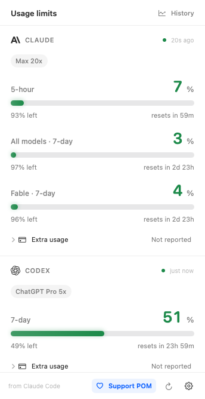
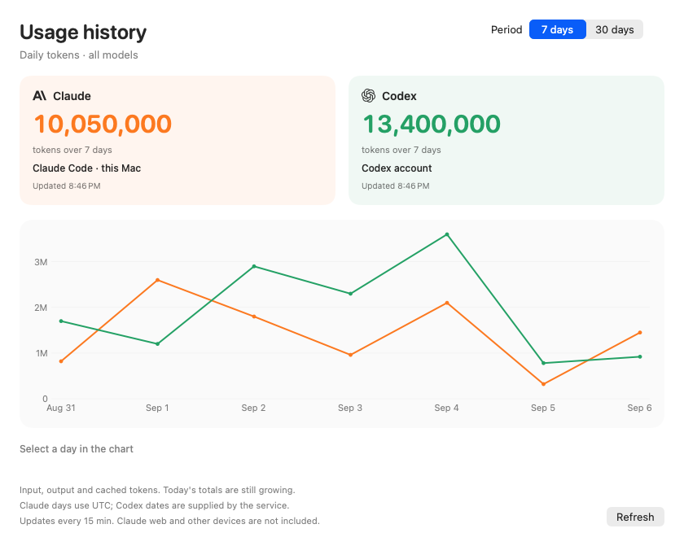

# POM — Claude & Codex usage limits for macOS

**Know how much usage you have left, without leaving your work.**
POM is a native Mac menu bar app that brings Claude and Codex subscription limits,
reset times and extra credits into one small window.

[🇱🇹 Lietuviškai](README.lt.md) · [Downloads](https://github.com/ponasObuolys/POM-Ponas-Obuolys-Metrics/releases) · [Installation help](docs/INSTALL.txt)


> **[POM 2.2.3 is available](https://github.com/ponasObuolys/POM-Ponas-Obuolys-Metrics/releases/tag/v2.2.3)** for Apple silicon and Intel Macs.
> This release is **not Apple-notarized** and uses an ad-hoc app signature. macOS may
> block the first launch. Developer ID signing and notarization are still pending.

<p></p>

## What you can see

- **Claude:** five-hour, weekly all-model usage and a separate Fable weekly limit when reported.
- **Codex:** the longest window in the main Codex usage bucket, plus the account's ChatGPT plan.
- **Extra usage:** Claude's enabled state, monthly usage percentage and spending amounts when currency/scale are provided; Codex credit balances, monthly credit limits and available limit resets when reported. POM does not buy or redeem credits.
- **Several indicators at once:** choose Claude, Fable and Codex individually in the menu bar. Switch between used and remaining percentages.
- **Useful notifications:** configurable low-limit warnings and a notification when fresh data confirms that an exhausted limit has recovered.
- **7- and 30-day token history:** two daily series, Claude and Codex, with totals across all models. Claude Code usage comes from this Mac; Codex usage comes from your account.
- **English and Lithuanian:** follows your Mac's primary language, with an immediate manual switch in Settings. Other system languages use English.
- **Update checks:** Sparkle reads a signed update feed. For this unnotarized release it opens the download page; direct in-app installation is reserved for future notarized releases.



*Interface previews use sample data. Token totals do not reset with quota windows. Claude includes input, output, cache reads and cache writes, deduplicated across local sessions and subagents. Claude web and other devices are not included. Codex uses account token totals as reported by the service. Claude days use UTC; Codex supplies date-only buckets without timezone metadata. Today is partial. These are token counts, not billing amounts or a forecast.*

History refreshes every 15 minutes. The first Claude import runs in small background
batches; later refreshes read only appended bytes. No transcript contents are read
when files have not changed. There is no permanent extra CLI process.

## Install

1. Download the DMG from [GitHub Releases](https://github.com/ponasObuolys/POM-Ponas-Obuolys-Metrics/releases).
2. Drag **POM** into **Applications** and open it there.
3. Sign in to Claude Code and/or Codex CLI. POM will read the available limits automatically.
4. Click the menu bar indicators. Use **Settings → Language** to change the language and **History** to open the charts.

Requires **macOS 14 Sonoma or later** and at least one installed, signed-in CLI:
[Claude Code](https://code.claude.com/docs/en/overview) or [Codex](https://github.com/openai/codex).
The optional Claude status-line bridge additionally needs `jq`. The Claude control protocol is version dependent (tested with Claude Code 2.1.263); older versions may need updating.

**macOS warning:** releases through 2.2.3 are not notarized. This
can trigger a Gatekeeper warning on another Mac. A self-signed certificate does not
solve that. Do not disable Gatekeeper or treat a malware warning as a routine install
step. Use the [signing status above](#pom--claude--codex-usage-limits-for-macos) and
[Apple's guidance](https://support.apple.com/en-us/102445) to identify the warning.

Version 2.1.2 has no in-app updater. Download the 2.2.3 DMG and replace POM in
Applications. **Check for Updates…** in 2.2.3 will check the signed feed; this
release uses an informational link for manual download. EdDSA update signatures
verify file integrity and do not replace Apple notarization.

Codex recovery notifications require the backend to explicitly report that ordinary usage is allowed. If your CLI omits this field, POM does not claim that access has recovered from percentages alone.

## Privacy and data

POM asks the installed CLIs for usage; it does not send a chat message to a model.
CLI sign-in and credential refresh remain with the respective provider. No separate
API key is needed. An optional Claude server fallback is disabled by default.

POM stores recent limits and 30 days of token metadata in `~/Library/Application Support/POM`.
Claude sessions are read locally to extract counts. The index stores hashed message/file
identifiers, offsets, dates and counts, never prompts, messages or access tokens.
Codex account history is fetched through the signed-in CLI and cached on this Mac.
POM does not upload history or add analytics. Missing sources are marked unavailable.
To remove the cache, quit POM and remove `claude-token-index.sqlite`,
`claude-tokens.json` and `codex-tokens.json` from that folder. They rebuild on the next launch.

## Build and contribute

```bash
swift run pom-tests
python3 tests/bridge_tests.py
bash scripts/check-ui.sh
bash scripts/bundle.sh
bash scripts/install.sh
```

The bundle script builds a universal **arm64 + x86_64** app using Swift Package Manager
and Apple's command line tools. `bash scripts/make-dmg.sh` creates a clearly marked
**development** DMG. This does not make it a trusted public installer.

See the [developer guide](claudedocs/README.md), [release signing guide](docs/RELEASING.md)
and [2.2.3 release notes](docs/releases/2.2.3.md). Bug reports should include your macOS,
POM and CLI versions plus the exact error text; omit credentials and private conversations.

## Support POM

[Support development via Stripe](https://buy.stripe.com/9B65kE4VZaDL5uI33F6Zy00) with an optional, one-time contribution. Choose your amount in EUR (€5 suggested). The recipient is Ponas Obuolys, MB. POM stays free and open source.

Use the visible **Support POM** button in the app, **Settings → Support POM…**, or the support link in the DMG. Checkout opens in your browser; no payment SDK or background work is added to POM, and payment details stay with Stripe.

A small, non-modal reminder appears on first launch and after a newer version, at most once every seven days. Relaunches and skipped updates do not trigger delayed reminders. Choose **Not now** or close the window to continue. A later eligible app update can show the reminder again. The last shown version and date stay on your Mac.

## License

[MIT](LICENSE). An independent project by Ponas Obuolys, not affiliated with Anthropic or OpenAI.
Provider marks belong to their respective owners. SVG assets are from
[Lobe Icons](https://github.com/lobehub/lobe-icons); see [third-party notices](Sources/POM/Resources/THIRD-PARTY-NOTICES.txt).
Updates use [Sparkle](https://sparkle-project.org/), distributed under its permissive license.
