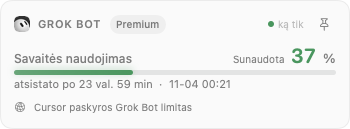

# Cursor ir Grok Bot metrikos

POM 2.3.0 kūrimo versijos funkcijos. Viešas POM 2.2.3 leidimas šių integracijų neturi.

## Cursor

Įdiegta Cursor programa aptinkama pagal jos vietinę paskyros duomenų bazę.
Metrikos iš pradžių išjungtos. POM lange **Įjungti Cursor metrikas** arba nustatymų
meniu esantis jungiklis leidžia naudoti esamą Cursor prisijungimą.

Įjungus skaitomas tik `cursorAuth/accessToken` iš
`~/Library/Application Support/Cursor/User/globalStorage/state.vscdb`, naudojant
SQLite tik skaitymo režimą. Raktas laikomas tik atmintyje ir siunčiamas tik į
`https://api2.cursor.sh/aiserver.v1.DashboardService/` duomenų užklausoms
`GetCurrentPeriodUsage` ir `GetPlanInfo`. HTTP peradresavimai neleidžiami.
POM nekopijuoja rakto, neieško naršyklės slapukų, neatnaujina prisijungimo ir
nesiunčia užklausų modeliui. Paskyra ir mokėjimo nustatymai nekeičiami.

Kai paskyra pateikia abu procentus, rodomi atskiri Auto ir kitų modelių limitai.
Kitu atveju rodomas pateiktas bendras procentas arba įtrauktos sumos ir limito
santykis. Papildomos išlaidos ir pateikta išlaidų riba rodomos USD.
Trūkstama riba nelaikoma nuliu. Savaitės atsistatymas imamas iš plano
metaduomenų; mėnesio atsistatymas rodomas patvirtinus mėnesinį periodą.
Nežinant periodo ar datos rodoma, kad atsistatymo laikas nežinomas.

Limitų klausiama kas 5 minutes; nesėkmės atveju laukimas didinamas iki valandos.
Rankinės užklausos galimos ne dažniau kaip kas 30 sekundžių. Pakeitus sesiją
ankstesni limitai pašalinami. Išjungus integraciją užklausa atšaukiama, o jos
rezultatas nebenaudojamas.

Tai vidinė Cursor sąsaja, kurios forma patikrinta įdiegtos programos kode.
Neatpažintas atsakymas parodomas kaip duomenų gavimo klaida. 2026-10-18 gavus
aiškų vartotojo leidimą gyvai patikrintos abi užklausos: tikras POM klientas
sėkmingai perskaitė paskyros planą, atskirus procentus, savaitės atsistatymo
datą ir papildomą naudojimą. Prisijungimo raktas nebuvo rodomas ar išsaugotas.

## Grok Bot

Integracija skirta macOS **Grok Bot** programai. Ji neskaito grok.com pokalbių
ir nėra atskira xAI API kreditų integracija.

### Tiesioginis atnaujinimas (darbinis kodas, 2026-11-03)

**Grok Bot iš serverio (Cursor paskyra)** nustatymas arba kortelės mygtukas įjungia
atskirą `GetSandUsageStatus` užklausą į tą patį Cursor DashboardService serverį.
Naudojamas esamas Cursor prisijungimas, nepriklausomai nuo Cursor metrikų jungiklio.
Grok Bot programa gali likti uždaryta. Tai **Cursor paskyros** Grok Bot limitas;
jeigu Grok Bot prisijungta kita paskyra, jos vietinė suvestinė su juo nemaišoma.

Užklausą naudoja pati įdiegta Grok Bot programa. Rodomas serverio `usagePercent`,
ne Cursor Auto/API procento kopija. Nauji bendro plano ir senieji atskiri limitai
lieka atskiri serverio sprendimai. `isUnified` atveju plano vardas imamas iš
`cursorPlanName`, kitu atveju — iš `grokPlanLabel`. Protobuf datos skaitomos kaip
ISO 8601. Trūkstamas procentas, pasibaigęs bandomasis planas ir bendras įmonės
limitas nelaikomi individualiu nuliniu limitu.

Užklausos vyksta kas 5 min., rankinės — ne dažniau nei kas 30 sek.; nesėkmės
atveju intervalas didinamas iki valandos. Paskyros/sesijos pasikeitimas pašalina
seną rodmenį. Išjungimas atšaukia užklausą ir neleidžia pavėluotam rezultatui
pakeisti vietinės suvestinės. Rakto POM neišsaugo ir nerodo. Papildomos Cursor
mėnesio išlaidos nekopijuojamos į bendro plano išankstinių kreditų rodmenį.

2026-11-03 rastas ir ištaisytas sesijos nuskaitymo defektas: naujesnis Cursor
`cursorAuth/accessToken` saugo `cursor-safe-storage:v1:` apvalkale. Ankstesnis
POM siuntė šifruotą tekstą kaip Bearer raktą; HTTP 401 nereiškė, kad vartotojui
reikia prisijungti iš naujo. POM dabar iššifruoja macOS `v10` apvalkalą su
`Cursor Safe Storage` / `Cursor Key` raktinės įrašu. Prieigos macOS gali paprašyti;
atsisakymas įsimenamas iki POM paleidimo iš naujo, kad foninis laikmatis nekartotų
dialogų. Raktinės įrašas nekeičiamas, paslaptys nerašomos į failus ar žurnalus.
Neatpažinta saugojimo versija ir neperskaitytas raktas yra vietinė klaida, ne 401.

Tikra patikra po pataisymo sėkmingai gavo vieną Grok Bot ir du Cursor limitus
2026-11-03 00:34 Vilniaus laiku. Patikrinti sintetiniai šifruotos SQLite sesijos,
seno formato, netinkamos versijos, blogo rakto ir neprieinamos raktinės atvejai.
Kriptografijos formatas atitinka [Chromium macOS OSCrypt](https://github.com/chromium/chromium/blob/130.0.6723.0/components/os_crypt/sync/os_crypt_mac.mm).

Nuotraukoje — sintetiniai testų duomenys.

### Vietinė suvestinė

Išjungus tiesioginį režimą, POM tikrina `~/Library/Application Support/Grok Bot/sand-client-persistence`
kas 30 sekundžių. Skaitomi tik du nedideli failai: aktyvios paskyros žyma
`sand.client.slice.client-meta.account-slot` ir tos paskyros
`sand.client.slice.account.<account>.weekly-usage.cache` suvestinė.
Failų vardai koduojami Base32; paskyros daliai naudojamas URI kodavimas.
POM neskaito programos paslapčių, kitų paskyrų suvestinių ar pokalbių.

Rodomas savaitės procentas, atsistatymo laikas, pateiktas plano vardas ir
papildomos išlaidos, kai jos yra suvestinėje. Antraštės laikas yra **Grok Bot
duomenų gavimo laikas**. Naujesnius skaičius išsaugo pati Grok Bot programa,
kai atveriamas paskyros meniu ar Usage & Billing. POM serverio neklausia.
Seni duomenys turi pasenimo žymą. Pasibaigus suvestinės galiojimui, atsijungus
ar pakeitus paskyrą be tinkamos suvestinės procentas nerodomas. Pasibaigęs
atsistatymo laikmatis savaime nepaverčia naudojimo nuliu.

Grok Bot ir Cursor gali dalintis bendru planu. POM rodo kiekvienos programos
reikšmes, jų nesumuoja. Paslaugos pasirenkamos per **Paslaugos** lango viršuje
arba **Nustatymai → Rodomos paslaugos**. Suvestinės kortelės ir meniu juostos indikatoriai pasirenkami atskirai. Šie šaltiniai nepridedami prie Claude/Codex tokenų istorijos
ir nesiunčia atskirų pranešimų apie limitus.

## Piktogramos

Meniu juostoje, skilčių antraštėse ir šaltinių pasirinkimo meniu naudojamas
tas pats `ProviderMarkView` komponentas. Cursor ženklas paimtas iš oficialaus
[ženklų paketo](https://cursor.com/brand) (2D kubas), o Grok Bot piktograma —
nepakeista oficialios macOS programos piktograma su veidu. Cursor ženklas
prisitaiko prie sistemos temos, Grok Bot išsaugo originalias spalvas ir akių
detales. Abu failai supakuoti su POM; kitų programų įdiegimas ir tinklas
piktogramoms nereikalingi. Šaltiniai nurodyti `THIRD-PARTY-NOTICES.txt`.

Fable identifikuojamas Claude modelių šeimos simboliu, o ne maža F raide.
Naudojamas to paties Lobe Icons rinkinio `claude.svg`; šakninių SVG matmenų
vienetai pritaikyti AppKit. Ženklas bendras kortelei, pasirinkimo meniu ir
meniu juostai, patikrintas šviesioje ir tamsioje temose.

## Bento suvestinė

744 taškų pločio langas rodo tik pasirinktas paslaugas. Pagrindinė kortelė
užima visą viršutinę eilutę, kitos išdėstomos dviem skiltimis. Nelyginė
paskutinė kortelė užpildo visą eilutę. Tikras turinio aukštis matuojamas;
pagrindinės kortelės plotas visada didesnis už kitų. Kortelės animuotai
persidėlioja keičiant pasirinkimą; gerbiamas sistemos Reduce Motion nustatymas.

Automatinį prioritetą nustato didžiausias paslaugos **sunaudoto limito
procentas**. Claude lyginami 5 valandų ir bendras savaitės limitai; Fable turi
atskirą kortelę. Cursor lyginami atskiri Auto ir kitų modelių procentai.
Pasibaigęs laikmatis ir trūkstami duomenys nelaikomi nuliu ir nelaimi
prioriteto. Vienodi procentai išlaiko stabilią paslaugų eilę. Tai nėra
tikslus tokenų skaičių palyginimas.

Segtukas kortelės antraštėje leidžia ją rodyti didžiausią nepriklausomai nuo
procento. Prisegta gali būti tik viena paslauga; paspaudus kitą segtuką ji
pakeičiama. Atsegus arba išjungus prisegtą paslaugą grįžtama prie automatinio
prioriteto. Pasirinkimas išsaugomas tarp paleidimų.

Pagrindiniai limitai, likučiai, atsistatymo laikai, planai ir rodmenų amžius
matomi iš karto. Kreditų suvestinės lieka kortelėse, o detali išklotinė
atsiveria atskirame langelyje, todėl nekeičia tinklelio aukščio.

## Patikra

Sintetiniai testai tikrina atskirus limitus, nulį, trūkstamus laukus, išlaidas,
savaitės ir mėnesio periodus, netinkamus atsakymus, sesijos skaitymą, aktyvios
paskyros parinkimą, kodavimą, suvestinės amžių ir galiojimą. SwiftUI patikros
atvaizduoja LT/EN skiltis ir indikatorius bei tikrina išjungimą užklausos metu
ir paskyros pakeitimą su nepavykusiu atnaujinimu.

Bento patikros atvaizduoja visus 31 netuščią paslaugų pasirinkimo derinį,
visus penkis prisegimo variantus ir pasibaigusių laikmačių bei nepavykusio
atnaujinimo būsenas. Patikrinti LT/EN tekstai ir abi temos; matuojamas
lango aukštis (mažiau nei 740 taškų) ir slinkimo konteinerio nebuvimas.
Geometrijos patikros tikrina, kad kortelės nepersidengtų, turinys nebūtų
nukirstas, o pagrindinė kortelė turėtų didžiausią plotą.

2026-10-18 universalus arm64/x86_64 kūrimo paketas įdiegtas į
`/Applications/POM.app` ir paleistas. POM lange patikrinti tikri abiejų
paslaugų rodmenys. Įjungti Cursor/Grok Bot meniu juostos indikatoriai,
išsaugant ankstesnius pasirinkimus. Ankstesnė programa ir nustatymai
išsaugoti `dist/backups/`. Tai vietinis atnaujinimas, viešas leidimas nesukurtas.

Šaltiniai: [Cursor CLI naudojimas](https://cursor.com/docs/cli/reference/slash-commands),
[Grok Bot planai](https://cursor.com/help/grok-bot/plans).
