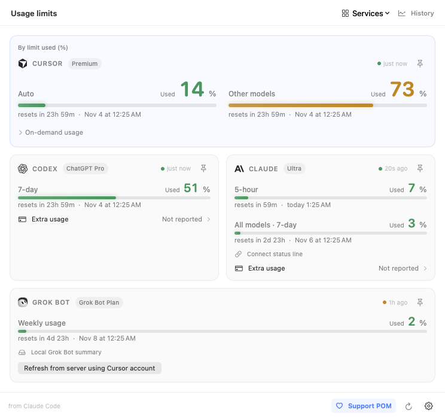
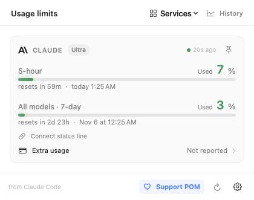

# Usage interface improvements (development)

These changes are in the working source, not the public 2.2.3 download.

- **Settings → Show remaining usage** applies to every quota number and bar, including the dashboard. Colors and alerts still indicate how much has been used. Expired limits remain unknown until a fresh reading confirms recovery.
- **Services → In dashboard / In menu bar** are independent. Each selection keeps at least one provider. On first launch of this version, the dashboard copies the existing menu selection; subsequent changes are independent. Cursor access remains opt-in.
- **Settings → Layout** chooses the existing cards (default, 744 pt) or a compact list (420 pt). Long content scrolls while the header and footer remain visible. Each quota gets its own row.
- **Settings → Card order** retains automatic usage ordering and pinning by default. Choose **My order**, then **Services → Reorder → provider → Move up/down** for a persistent manual order. Pins are hidden in manual mode and restored in automatic mode. Hiding a pinned dashboard service removes its pin; hiding only its menu indicator does not.
- Click a freshness indicator for the source, original capture time, explanation and refresh/sign-in actions. Refreshes respect existing rate limits. Grok Bot refresh only rereads its local summary; fetch new server readings in Grok Bot itself.
- Reset times show both the countdown and local date/time. The tooltip includes the full date and timezone. History buckets retain their original date semantics instead: UTC for Claude, provider dates for Codex.

## Previews

Synthetic data from the SwiftUI checks:




## History

7/30-day totals and charts still include today. Daily averages exclude today (6 completed days in the 7-day view, 29 in the 30-day view). The 7-day view additionally compares yesterday and the preceding six days with the seven days before that; the intervals are printed explicitly. No monthly comparison or longer retention is added.

Comparisons and averages require a collection refreshed today with no unfinished import, skipped Claude records or refresh failure. Missing buckets in completed desktop summaries retain the existing zero interpretation. Comparisons are labelled as based on available records, not a guarantee of account-wide coverage. A zero baseline produces an absolute token change instead of a percentage.

Chart checkboxes filter the graph and selected-day values only; at least one remains enabled. Totals and exports continue to include both available providers. Codex uses a dashed line, Claude a solid line.

## Export

Choose **Export → JSON / CSV**. Both formats use the selected 7/30-day interval, named in the filename, and existing in-memory summaries. No collection or network request is started. Missing days are not fabricated in either file.

JSON retains schema v1, source/status fields and original update timestamps (ISO 8601 seconds), so POM Companion can import it. A seven-day export intentionally contains no earlier comparison data. CSV is UTF-8 with CRLF rows and stable columns:

```text
source,day,tokens,updated_at,collection_status
```

Only usage summaries are exported, never conversations or credentials.

## Verification

Run the existing `swift run pom-tests`, `bash scripts/check-ui.sh`, and `bash scripts/check-companion.sh` checks. For desktop-to-Companion fixture import checks, run the UI checks first, then set `POM_REPORT_FIXTURES="$PWD/.build/ui-checks"` when running the Companion script.

This Mac uses `POM_BUILD_SDK=/Library/Developer/CommandLineTools/SDKs/MacOSX26.5.sdk` and `POM_BUILD_SYSTEM=native` for both scripts. Source tests cover migration, independent selections, reorder/pins, live panel resizing, completed-week math, failed/partial history, local midnight/DST, sparse exports, and 7/30-day imports. Visual fixtures include both layouts/languages/themes with one and five providers, all 31 card selections, and status details.

Validation on 2026-11-03: 365 core checks, SwiftUI rendering/integration checks
(including live layout switching), 24 Companion data checks plus desktop 7/30-day
imports, 5 bridge tests and 9 Apple preflight tests passed. The application and
Companion preview built with the SDK override above. No release was published.
