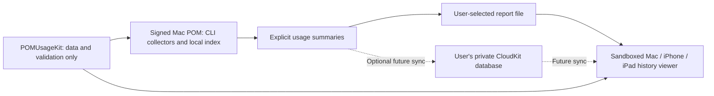

# ADR-001: POM on Mac, iPhone and iPad

**Status:** Proposed; shared data/export and standalone report viewer implemented locally.
**Date:** 2026-09-07
**Deciders:** POM owner; Apple controls membership and App Review, and Anthropic controls access to its data.

## Context

POM should remain lightweight, retain its native Mac experience, and become easier to install through
Developer ID signing and notarization. The owner also wants Mac App Store and iPhone/iPad distribution,
ideally with complete account history for both providers.

Two limits must be distinguished: a provider's current subscription quota and historical token totals.
POM can already obtain Claude quota snapshots through Claude Code. That does not provide complete
historical token totals for all Claude products or devices. It is not valid to infer those totals from
percentages, plan multipliers, subscription prices or chat-text token estimates.

### Verified provider access

| Source | What it actually covers | Consequence |
| --- | --- | --- |
| Claude Pro / Max | Official Claude Code usage analytics are unavailable for individual plans | No documented supported API for the requested full Max account token history was found |
| Claude Team | Owners have an analytics dashboard | A dashboard is not proof of a supported API for the desired totals |
| Claude Console APIs | API organization data; Admin key required | API usage must not be presented as a Pro/Max subscription's usage |
| Claude Enterprise Analytics | Organization analytics; dedicated Analytics key | Cost/token endpoints cover usage-based plans; seat-based plans reflect usage credits only |
| POM Claude local index | Claude Code sessions found on the exporting Mac | Remains explicitly local, even when transferred to an iPhone |
| POM Codex account history | Account buckets returned by local signed-in `codex app-server` | Account-sourced data still depends on a Mac collector; it is not a public iOS login/API integration |

Sources: [Pro/Max limitation](https://support.claude.com/en/articles/12157520-claude-code-usage-analytics),
[analytics API eligibility and key types](https://platform.claude.com/docs/en/manage-claude/analytics-api).

Do not switch the owner's Max plan to paid API use or buy Enterprise solely to implement this idea.
Adding an Anthropic API key cannot retroactively reveal Max subscription activity. A future supported
consumer analytics API can be added as a separately labelled source if Anthropic provides one.

## Decision

Keep the complete downloadable Mac app. Build separate sandboxed store clients around a shared data
package. The first store-client design has its own useful history-viewing functionality: import a summary
file from Files/iCloud Drive, inspect daily totals and source coverage, compare periods and export reports.
Optional private CloudKit sync can then provide current Mac-collected summaries and quota snapshots.

The diagram describes the target architecture, not a deployed sync service. Apple App Review acceptance
is not guaranteed by this separation. Minimum-functionality and external-dependency requirements need
review against the actual completed client before submission.

### Distribution boundaries

| Component | Downloadable Mac app | Mac App Store / iOS / iPadOS client |
| --- | --- | --- |
| CLI subprocesses and local transcript scanning | Existing collectors | Excluded from store target dependencies |
| History | Original local/account source metadata | Imported/synced metadata preserved; unavailable never becomes zero |
| Updates | Signed Sparkle feed | App Store updates; no Sparkle |
| Support | Current voluntary Stripe link | Proposed optional StoreKit tip products, evaluated for target storefronts |
| Data access | Existing provider authentication stays on Mac | User-selected files; optional private iCloud data |
| Background work | Existing bounded scans and refresh intervals | System-scheduled sync; no promise of continuous background execution |

This is a proposed global StoreKit path, not a claim that every external-payment link is forbidden in
every region. The owner's requirement for visible but dismissible support prompts should be preserved
within the applicable storefront rules. POM is not presented as a registered charity.

Source: [App Review Guidelines](https://developer.apple.com/app-store/review/guidelines/), particularly
2.4.5, 2.5.2, 3.1.1 and 4.2.3.

### Data and sync contract

- `Packages/POMUsageKit` has no dependencies on CLI, AppKit, Keychain, Sparkle, SQLite or networking. It declares macOS 14 and iOS/iPadOS 17 support and has been compiled in Mac and iOS Simulator apps.
- `UsageHistoryReport` v1 contains up to two source-tagged 30-day snapshots, timestamps, collection status and integer totals. It validates size, dates, source, schema, duplicate days and numeric bounds. It does not include credentials, prompts, account names or paths.
- Desktop **Export…** serializes summaries already in memory. It does not scan more transcripts, invoke a CLI or upload anything. The file-picker operation is initiated by the user.
- File imports must replace a selected report or remain separately labelled. Blindly adding two reports would double-count overlapping sessions or account totals. The v1 format deliberately does not promise cross-Mac merging.
- Before live sync, add explicit provider-account binding, opaque publisher IDs, capture revision and date-basis metadata. Do not merge records solely by display name or email.
- Codex account totals read on multiple Macs represent the same underlying account: choose the latest valid authoritative snapshot; do not sum them.
- Start Claude sync with one chosen publisher Mac. Multi-Mac totals require reliable deduplication of overlapping/copied sessions and must remain labelled as collected Claude Code use, not all Claude account use.
- Keep the original capture time and display stale/offline/partial states. A sleeping or disconnected Mac cannot promise live data. Zero is a measured value; missing is missing.
- Use one entitled CloudKit container and the current user's **private** database. Never put provider credentials or conversation text into CloudKit. Sync is optional with a visible off/delete control and clear scope explanation.
- Proposed record identifiers are stable within account/source/publisher scope; conflict handling uses version/change-tag checks, idempotent writes and bounded backoff. Old uploads cannot overwrite newer readings. Deletion and iCloud account changes must clear or segregate local caches.
- Reuse the existing 15-minute history work; upload only changed small summaries, respecting Low Power Mode and system background scheduling. No new always-on polling or POM account/server is needed for this design.

Source: [CloudKit databases](https://developer.apple.com/documentation/cloudkit/designing-and-creating-a-cloudkit-database).

## Options considered

| Option | Complexity | Cost / maintenance | Assessment |
| --- | --- | --- | --- |
| Full consumer account APIs on every device | Currently blocked by missing supported Claude Max history API | Unknown future provider access | Revisit if a suitable documented API becomes available |
| Existing Mac collector + portable summaries + optional private CloudKit | Medium; separate store UI and sync logic | Apple membership and ongoing testing; no POM backend initially | Recommended foundation; preserves truthful scope |
| Ship the existing CLI-heavy app unchanged to all stores | High compatibility/review risk; cannot run its CLI on iOS | Likely substantial rework | Not an implementation plan |
| Hosted backend holding users' provider credentials | High security and operational burden | Hosting, auth and support costs | Not justified for a lightweight free utility and does not solve missing APIs |

## Consequences

Signing and notarization can be completed before the store project. Mobile use initially relies on
exported or Mac-synced observations, not direct login to a complete Claude Max history endpoint. Store
clients need provisioning, privacy disclosures and physical-device tests. A separate SwiftUI report
viewer and multiplatform project now compile for Mac and iOS Simulator. The core interface flow passes
on iPhone and iPad simulators, and a local ad hoc Mac build has imported a report within App Sandbox.
This is still a development preview, not a ready store release.

## Execution status and acceptance criteria

- [x] Verify provider access against official documentation; record unsupported assumptions.
- [x] Open Apple enrollment; owner is signed in and at the personal-information form. Publisher choice remains pending.
- [x] Add read-only signing/notarization/Xcode preflight and connect it to release preparation.
- [x] Extract portable history models; preserve the existing desktop API through type aliases.
- [x] Add bounded, source-labelled report export and malformed-input tests.
- [ ] Owner signs in, selects publisher, completes identity/organization verification, agrees and pays Apple.
- [x] Complete Xcode first launch/license and install iOS SDK/simulator; Xcode 26.6 and runtime 26.5 are available.
- [ ] Create actual Developer ID identity and notarization profile; configure CI secrets securely.
- [ ] Build a new notarized DMG, verify Gatekeeper and install/update on another Mac.
- [x] Create separate macOS/iOS app project linked only to POMUsageKit and companion UI/data services; compile its Mac SwiftPM preview.
- [x] Implement report import, totals, source/freshness UI, week comparison with explicit latest-day caveat, local cache/removal and export without requiring an active Mac.
- [x] Check report replacement, malformed/oversized input, offline restore, example isolation, missing readings and period dates; render LT/EN at compact/desktop widths.
- [x] Compile actual Mac/iOS Simulator targets; test the UI flow on iPhone 17e and iPad (A16), and import a synthetic report into a local Mac sandbox build.
- [ ] Test physical-device file import/export, iCloud Drive downloads, accessibility and release performance.
- [ ] Register actual bundle IDs and CloudKit container under the confirmed team; implement opt-in sync and account isolation.
- [ ] Test repeated imports, duplicated Codex data, reordered writes, offline Mac, stale data, iCloud sign-out, deletion, partial import and daylight-saving boundaries.
- [ ] Configure StoreKit tips with the owner's chosen products; test purchase/cancel/restore as applicable.
- [ ] Validate macOS sandbox access, iPhone/iPad layouts, VoiceOver, LT/EN, memory, CPU and background energy on real devices.
- [ ] Prepare App Store metadata/privacy/support URLs, reviewer demo reports and review notes; submit through App Store Connect and address review feedback.

English/Lithuanian metadata, reviewer notes and a privacy disclosure draft are prepared in
`docs/app-store/companion-metadata-draft.md`; no public policy page or store listing has been published.

No store listing, CloudKit container, payment product, Developer ID or membership has been created by
the code preparation above. The current installation and public 2.2.3 release are unchanged.
